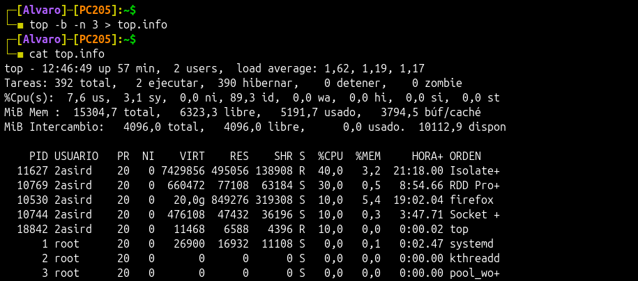
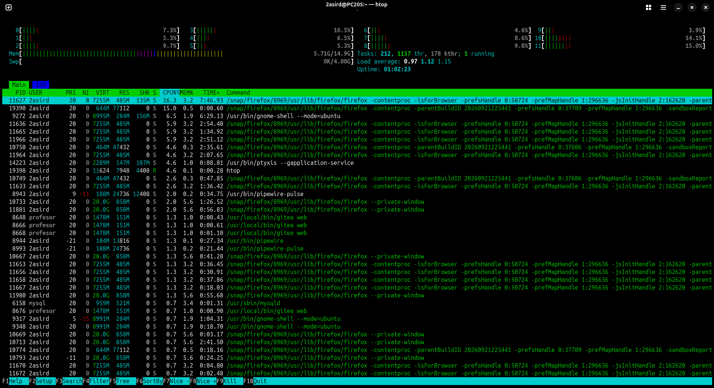
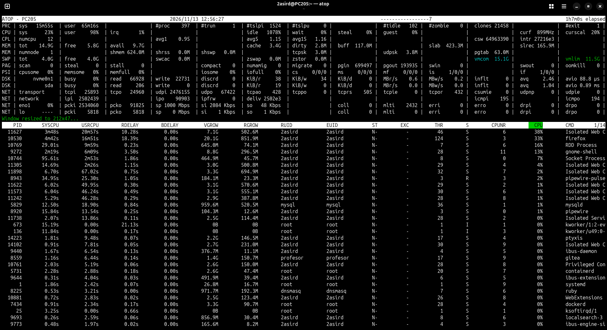

# Procesos

## Comando `ps`

Muestra información de los procesos activos

Con `ps a` se muestran todos los procesos de todos los usuarios.


Con `ps au` se muestra información sobre todos los procesos de todos los usuarios en formato largo.


Con `ps aux` se muestra información sobre todos los procesos de todos los usuarios en formato largo y con información adicional.


Con `ps -C` podemos buscar información sobre un proceso en concreto.


> [!TIP]
> También puedes emplear `u` para desplegar la información en formato detallado.
>
> 

## Comando `top`

Permite monitorear en tiempo real el uso de recursos del sistema, como CPU, memoria y procesos en ejecución.

  * `M`: Ordena por la cantidad de memoria RAM que están utilizando.
  * `P`: Ordena por el uso de la CPU.
  * `T`: Ordena según el tiempo total de CPU acumulado que han utilizado.
  * `N`: Ordena los procesos por el PID en orden ascendente.
  * `R`: Invierte el orden de la columna seleccionada para ordenar.


> [!NOTE]
> #### Para guardar una salida de datos que recoja top emplearemos el siguiente comando:
>
> ```bash	
> top -b -n 3 > top.info
> ```
>
> `-b` Adapta el resultado a un formato de texto plano para poder almacenarlo.
>
> `-n 3` Realiza el análisis 3 veces y finaliza.
>
> `> top.info` Guarda toda la información obtenida en el archivo `top.info`.
>
> 

## Comando `htop`

Es una herramienta interactiva y visual para monitorizar y gestionar procesos en Linux, con una interfaz amigable y opciones avanzadas.



## Comando `atop`

Es una herramienta de monitorización avanzada para sistemas Linux, que proporciona información detallada sobre el uso de recursos y procesos.


