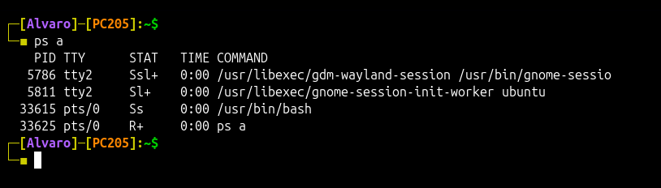
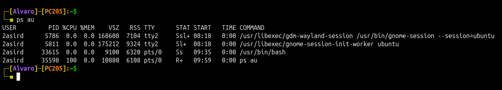
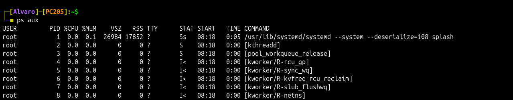
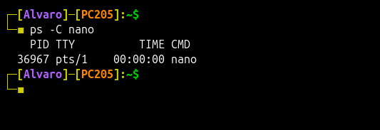
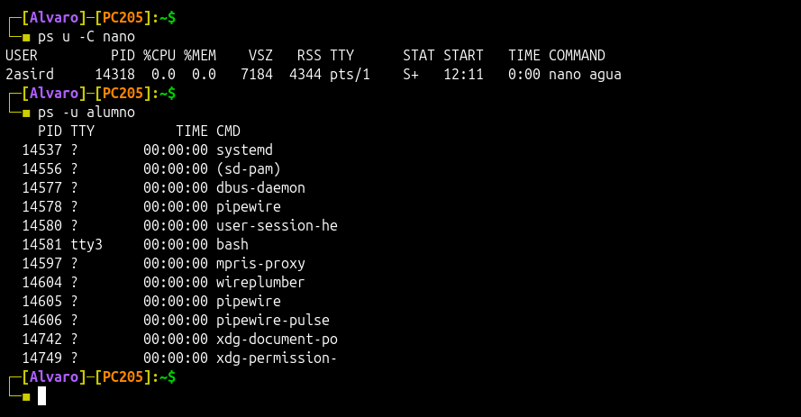
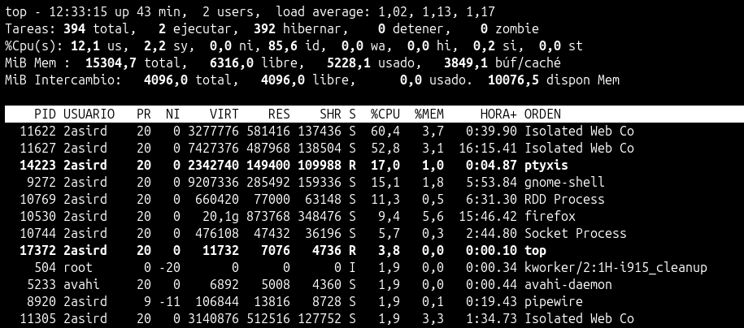

# Procesos

## Comando `ps`

Muestra información de los procesos activos

Con `ps a` se muestran todos los procesos de todos los usuarios.

Con `ps au` se muestra información sobre todos los procesos de todos los usuarios en formato largo.

Con `ps aux` se muestra información sobre todos los procesos de todos los usuarios en formato largo y con información adicional.

Con `ps -C` podemos buscar información sobre un proceso en concreto.

> [!TIP]
> También puedes emplear `u` para desplegar la información en formato detallado.
>
> 

## Comando `top`

Permite monitorear en tiempo real el uso de recursos del sistema, como CPU, memoria y procesos en ejecución.

  * `M`: Ordena por la cantidad de memoria RAM que están utilizando.
  * `P`: Ordena por el uso de la CPU.
  * `T`: Ordena según el tiempo total de CPU acumulado que han utilizado.
  * `N`: Ordena los procesos por el PID en orden ascendente.
  * `R`: Invierte el orden de la columna seleccionada para ordenar.

ps a:

ps au:

ps aux:

ps -C:

ps u -C:

ps -u alumno:

ps -C nano:

top:
    M: Ordena por memoria
    P: Ordena por CPU
    T: Ordena por tiempo de uso
    N: Ordena el PID de mayor a menos y al usar la R ordena de menor a mayor.

htop:

ejercicio:

- Utilizando el comando top necesitamos mandar a nuestro jefe de proyecto un lista de los 10 procesos que consumen más cpu durante tres periodos consecutivos.

atop:
    t: muestra cada registro y su fecha
