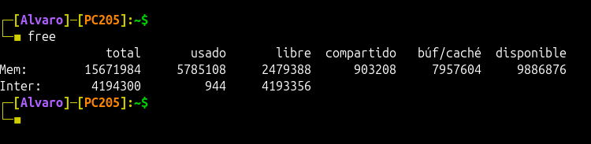
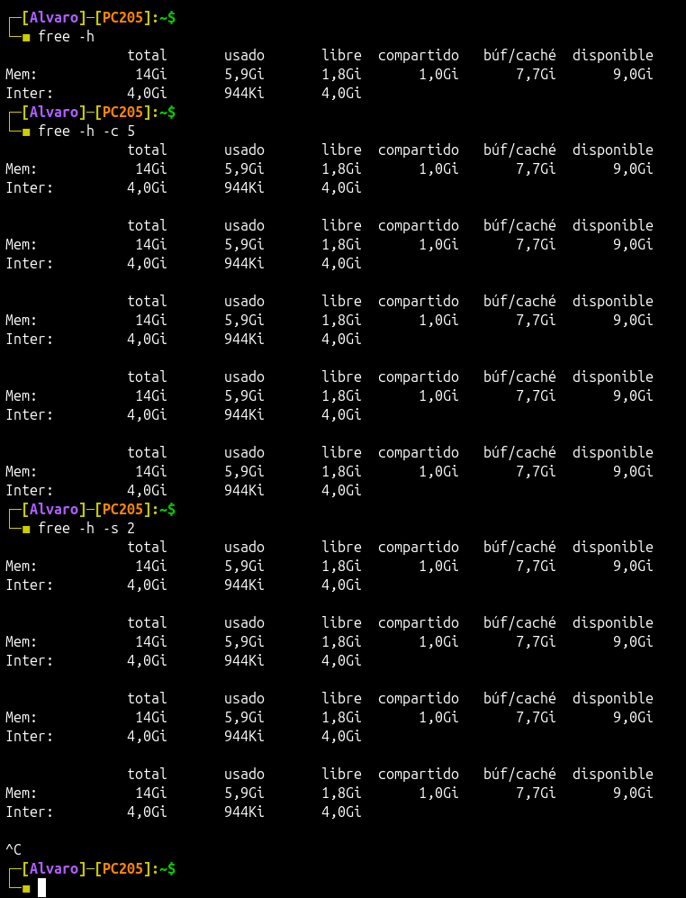
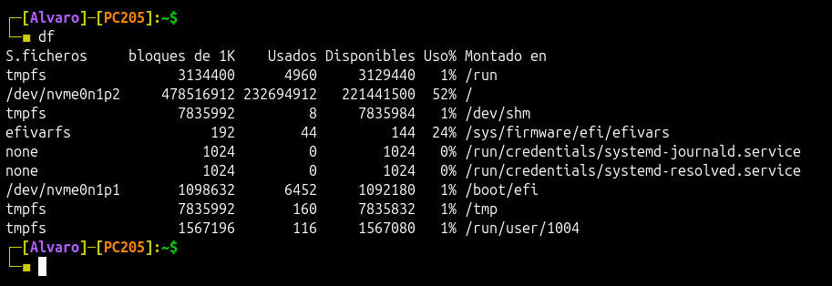
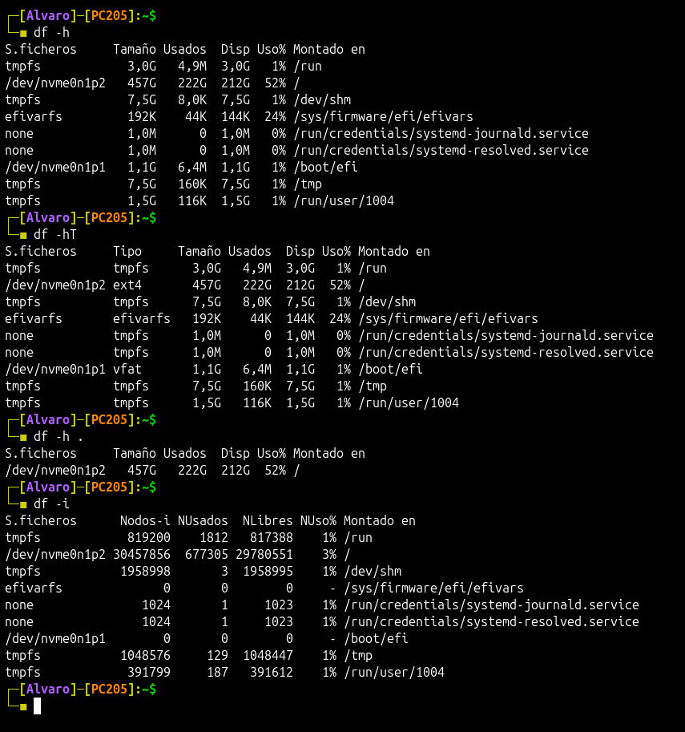

# MEMORIA Y DISCO

## Comando `free`

Muestra la cantidad de memoria libre y utilizada en el sistema.



Pueden emplearse varias opciones con este comando para cumplir distintas funciones:

* `-h`: Presenta los tamaños en unidades legibles, como MiB o GiB.
* `-c N`: Muestra N actualizaciones y termina.
* `-s N`: Actualiza cada N segundos; continúa hasta interrumpirlo con Ctrl+C.

### Ejemplos

```bash
# Mostrar la memoria en unidades legibles
free -h

# Mostrar cinco actualizaciones
free -h -c 5

# Actualizar cada dos segundos
free -h -s 2
```


## Comando `df`

Nos permite ver el espacio en disco disponible y utilizado en el sistema.



De la misma forma que el anterior comando, se pueden emplear varias opciones para desempeñar distintas funciones:

* `-h`: Muestra los tamaños en unidades legibles.
* `-T`: Añade el tipo de sistema de archivos.
* `i`: Muestra el uso de inodos en lugar del espacio en bloques.

### Ejemplos

```bash
# Consultar el espacio de todos los sistemas de archivos
df -h

# Consultar el espacio y el tipo de sistema de archivos
df -hT

# Comprobar el espacio disponible en la ruta actual
df -h .

# Consultar el uso de inodos
df -i
```


