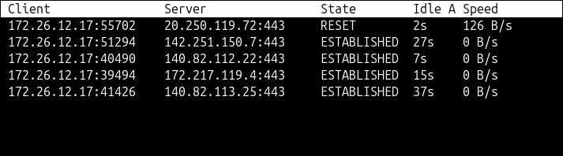
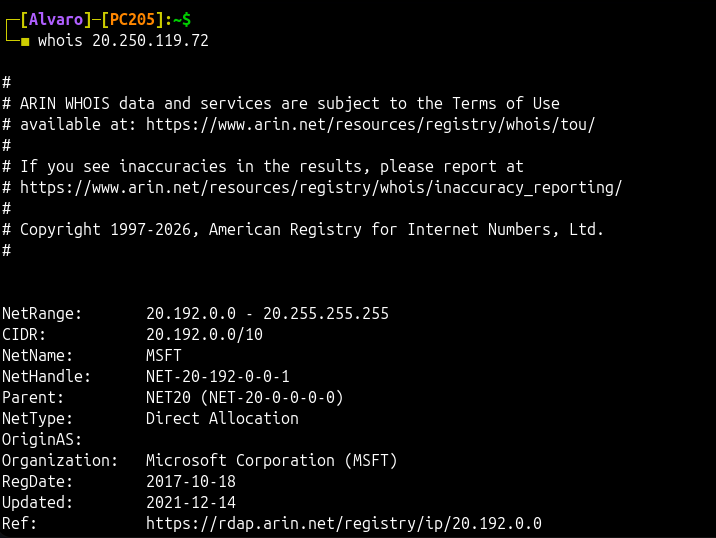
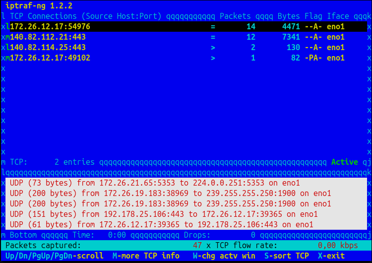
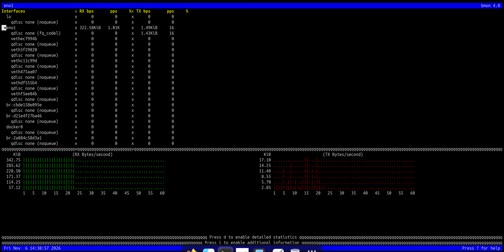
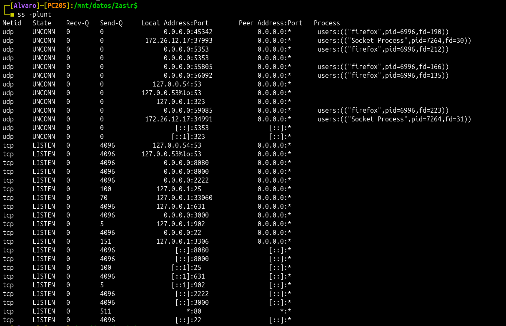
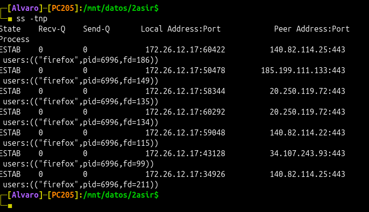

# Tráfico de la Red

## Comando `tcpdump`

Se usa para capturar y analizar el tráfico de red que entra y sale del equipo en tiempo real.


### COMANDO PARA GUARDAR EL TRÁFICO EN UN ARCHIVO

```bash
sudo tcpdump -i eth0 -nn -w trafico_web.pcap
```


## Comando `tcptrack`

Se usa para monitorear el tráfico de red en tiempo real, mostrando de forma visual y ordenada qué conexiones TCP activas existen, quién se conecta, a qué velocidad y cuántos datos está consumiendo cada una.

Para usar `tcptrack`, vamos a escribir la interfaz de red que queremos monitorear. En mi caso, será la interfaz `eno1`:

```bash
sudo tcptrack -i eno1
```



## Comando `whois`

Se usa para consultar quién es el propietario de un dominio web y los datos de registro.

Para usarlo se requiere introducir una IP. Por ello, voy a emplear `20.250.119.72`, una de las IPs que observamos con `tcptrack`:



## Comando `iptraf-ng`

Se usa para monitorear el tráfico de red y ver estadísticas detalladas en tiempo real mediante una interfaz visual en la terminal.



## Comando `bmon`

Se usa para monitorear el ancho de banda y el tráfico de red en tiempo real mediante gráficos y barras visuales en la terminal.



## Comando `ss`

Se usa para mostrar estadísticas y conexiones de red activas.

Para este comando vamos a emplear dos variaciones:
   * `ss -plunt`: Muestra todos los puertos abiertos que están escuchando conexiones, indicando el número de puerto y el proceso o programa exacto que los está usando.
   * `ss -tnp`: Muestra todas las conexiones TCP activas de forma numérica, detallando también qué proceso o programa está usando cada una.




