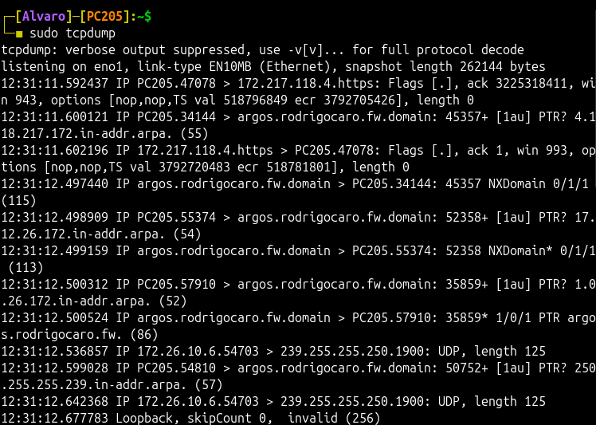

# Tráfico de la Red

## Comando `tcpdump`

Se usa para capturar y analizar el tráfico de red que entra y sale del equipo en tiempo real.



### COMANDO PARA GUARDAR EL TRÁFICO EN UN ARCHIVO

```bash
sudo tcpdump -i eth0 -nn -w trafico_web.pcap
```


## Comando `tcptrack`

Se usa para monitorear el tráfico de red en tiempo real, mostrando de forma visual y ordenada qué conexiones TCP activas existen, quién se conecta, a qué velocidad y cuántos datos está consumiendo cada una.
